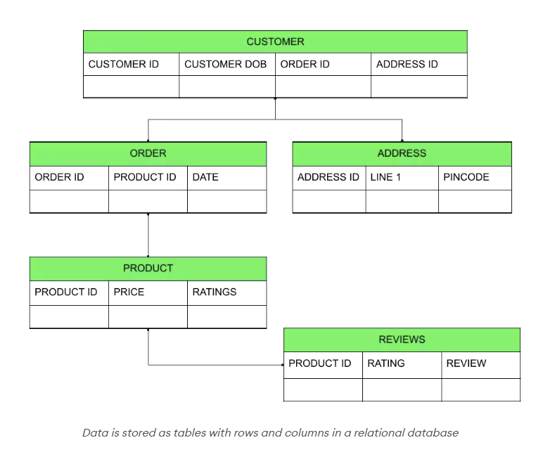

SQL Database 也就是關聯式資料庫 (Relational Database, RDBMS)：資料存成由 row 與 column 組成的 table，table 之間透過 key 建立關聯，並以 SQL 操作。

- [SQL 語言](/backend/database/sql-database/sql)：SQL 語法、JOIN、Transaction、Index 與在應用程式中使用 SQL 的筆記。

## What is structured data?

結構化資料的意思他的編排是固定的，format 等都是預先定義好的。

## SQL Database 與 SQL 語言

兩者常被混著叫「SQL」，但指的是不同層次的東西：

| | SQL Database | SQL 語言 |
| --- | --- | --- |
| 是什麼 | 一種資料庫系統（軟體） | 一種查詢與操作資料的語言 |
| 負責 | 儲存資料、執行查詢、維護 index、處理 transaction 與權限 | 描述「要做什麼」：查哪些資料、改哪些結構、給誰權限 |
| 例子 | PostgreSQL、MySQL、SQLite、Oracle | `SELECT`、`CREATE TABLE`、`GRANT` |
| 差異來源 | 儲存引擎、效能、擴展方式、功能、授權 | 各家在標準 SQL 之上的方言（函式、型別、語法細節） |

可以類比成「瀏覽器」與「JavaScript」：SQL 是共通的語言，SQL Database 是實際執行它的引擎，同一段標準 SQL 大多能在不同資料庫上執行，但進階語法與效能表現會因資料庫而異。

## 關聯式資料庫的特性

> Relational databases, or relational database management systems (RDBMSs)

- **事先定義 schema**：每張 table 的欄位、型別與 constraint 在寫入前就要決定，資料格式由資料庫保證。
- **以 key 建立關聯**：用 primary key 識別每一列，用 foreign key (e.g., unique identifiers) 指向其他 table，查詢時再用 `JOIN` 組合。
- **支援 transaction 與 ACID**：多個寫入可以包成一個交易，全部成功或全部失敗，適合金流、訂單、庫存這類要求一致性的資料。
- **查詢彈性高**：資料正規化後，可以用 SQL 從不同角度組合查詢，不必事先為每種讀取方式設計資料格式。
- **擴展以 vertical scaling 為主**：單機升級最直接；水平擴展需要 read replica、partitioning 或 sharding，複雜度較高。

## 什麼時候選 SQL Database

| 適合 | 不一定適合 |
| --- | --- |
| 資料結構穩定、關聯多（使用者、訂單、商品） | 結構常變動或每筆欄位差異很大的文件型資料 |
| 需要強一致性與 transaction | 極高寫入量、可接受最終一致性的場景（log、事件流） |
| 需要彈性的查詢、報表與聚合 | 只用 key 存取、追求極低延遲（cache、session） |

不確定時，關聯式資料庫（尤其 PostgreSQL）通常是穩妥的預設選擇；之後遇到特定瓶頸，再針對該部分引入 NoSQL。

## 常見的 SQL Database

| 資料庫 | 特色 | 常見場景 |
| --- | --- | --- |
| PostgreSQL | 功能完整、標準相容度高，支援 JSONB、CTE、window function 與豐富的 extension | 通用首選、需要複雜查詢的服務 |
| MySQL / MariaDB | 普及、生態系成熟，InnoDB 引擎支援 transaction | Web 應用、讀多寫少的服務 |
| SQLite | 嵌入式、單一檔案、免架設 server | 行動 App、桌面軟體、測試、小型工具 |
| Oracle | 商用、企業級功能與支援 | 金融、電信等大型企業系統 |
| SQL Server | Microsoft 生態系整合 | .NET / Windows 環境的企業系統 |

### MySQL

- [一小时MySQL教程](https://www.youtube.com/watch?v=nZlH5in_660&ab_channel=GeekHour)

### PostgreSQL

- [PostgreSQL Tutorial](https://www.postgresqltutorial.com/)
- [PostgreSQL Documentation](https://www.postgresql.org/docs/current/)
