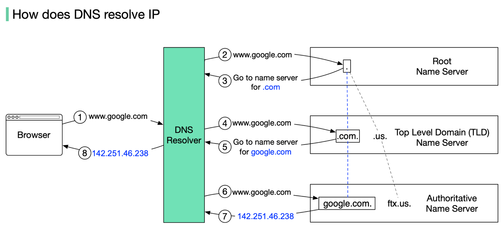
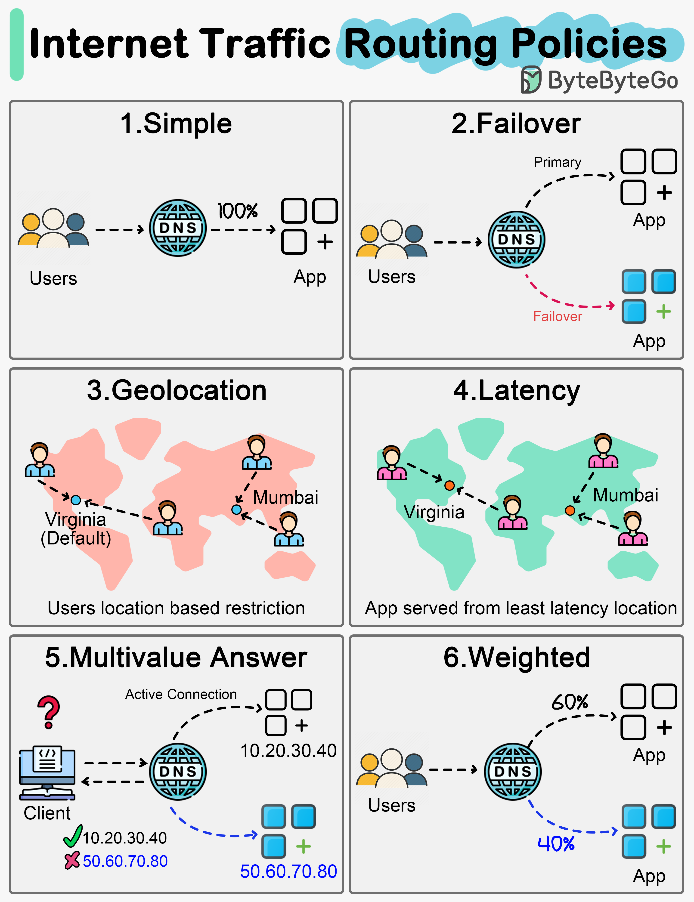

DNS 就像網路世界的通訊錄：把人看得懂的名字（`google.com`）轉成機器看得懂的 IP（`142.251.46.238`）。查詢通常用 **[UDP](/network/tcp-udp#tcp-vs-udp) port 53**，回應太大（超過 512 bytes，例如 DNSSEC）或做 zone transfer 時改用 TCP。



> 圖片來源：[ByteByteGo](https://bytebytego.com/guides/how-does-the-domain-name-system-dns-lookup-work/)

## 三層 DNS server

全世界的名字太多，一台 server 存不下，所以 DNS server 排成一棵分層的樹，每一層只管下一層在哪。網域名稱從右往左讀就是這棵樹：`www.google.com.` 最右邊其實藏著一個 `.`，那就是 **root**，往左依序是 TLD（`com`）、網域（`google`）、子網域（`www`）。

- **Root name server（`.`）**：存放各個 TLD name server 的位址，不知道 `google.com` 的 IP。全世界只有 13 個 logical root server（`a.root-servers.net` 到 `m.root-servers.net`），但每個背後都用 anycast 部署了很多台機器，實體 server 有上千台。Resolver 內建這 13 個的 IP（root hints），不用問別人就找得到 root。
- **TLD name server**：存放這個 TLD 底下各網域的 authoritative name server 位址（也就是 `NS` record），一樣不知道最終的 IP。TLD 分成幾種：
  - generic TLD（gTLD）：`.com`、`.org`
  - country code TLD（ccTLD）：`.us`、`.tw`
  - 保留給測試用的：`.test`，不會出現在公開的 DNS 上
- **Authoritative name server**：真正存放 `google.com` 各筆 record、給出最終答案的 server，可能是你自己架的，或 Route 53、Cloudflare。你在 GoDaddy、Namecheap 這類 registrar 設定 name server 時，改的是 TLD server 上指向它的那筆 `NS` record。

## 查詢流程

對照上圖：

1. 在瀏覽器輸入 `www.google.com`，瀏覽器（和 OS）的快取沒有，就把名字交給 DNS resolver（ISP 的，或 `8.8.8.8`、`1.1.1.1`）。
2. Resolver 去問 root name server。
3. Root 回答：「`.com` 去問這幾台 TLD server。」
4. Resolver 去問 `.com` 的 TLD server。
5. TLD server 回答：「`google.com` 去問這幾台 authoritative name server。」
6. Resolver 去問 `google.com` 的 authoritative name server。
7. Authoritative server 回傳 IP：`142.251.46.238`。
8. Resolver 把 IP 回給瀏覽器，並依 TTL 快取起來。

- **Recursive 查詢**：步驟 1 和 8，client 問 resolver，resolver 負責問到底再回答。
- **Iterative 查詢**：步驟 2 到 7，resolver 問 root、TLD、authoritative，每台都只回「下一個去問誰」。

沒有快取時，一次完整的 DNS 查詢平均要 20–120 ms（YSlow 的數據）。實際上 root 和 TLD 的答案 TTL 很長（`.com` 的 NS 是 2 天），resolver 快取之後，大部分查詢會直接跳到步驟 6，快取命中時更是幾乎不花時間。

## 常見的 Record 類型

| Record | 作用 | 例子 |
| --- | --- | --- |
| `A` | 名字 → IPv4 | `api.example.com → 93.184.216.34` |
| `AAAA` | 名字 → IPv6 | `api.example.com → 2606:2800::1` |
| `CNAME` | 名字 → 另一個名字（別名） | `www.example.com → example.com` |
| `MX` | 這個網域的 mail server，帶 priority，數字越小越優先 | `example.com → 10 mail1.example.com`、`20 mail2.example.com` |
| `TXT` | 任意文字，常用來驗證網域、SPF | `"v=spf1 include:_spf.google.com ~all"` |
| `NS` | 這個網域由哪幾台 DNS server 負責 | `example.com → ns1.example.com` |
| `PTR` | IP → 名字（反查），常用來檢查 mail server 是不是它自稱的那台 | `34.216.184.93.in-addr.arpa → api.example.com` |
| `SRV` | 某個服務在哪台 host、哪個 port | `_sip._tcp.example.com → 10 60 5060 sip.example.com` |

> `PTR` 不在你自己的 zone 裡，而是由 IP 的擁有者（ISP 或雲端業者）設定。

> `CNAME` 不能放在 zone apex（`example.com` 本身），因為那裡一定要有 `NS` 和 `SOA`。要讓根網域指向 load balancer 時，AWS Route53 用 **Alias record**、Cloudflare 用 **CNAME flattening** 來解決。

## TTL 與除錯

### 網路與資訊領域：存留時間（Time to Live）

在網路通訊中，TTL 是用來控制資料壽命的參數，最常應用在以下兩處：

- IP 封包（Ping / 路由追蹤）：
    - 作用：防止封包在網路上因為路由錯誤而無限循環消耗資源。
    - 運作方式：發送端設定一個初始數值（例如 Windows 預設 128、Linux/macOS 預設 64）。封包每經過一個路由器（稱為一「跳」/ Hop），數值就減 1。當減到 0 時，路由器就會捨棄該封包，並回傳超時訊息。
- DNS 記錄（網域名稱系統）：
    - 作用：決定 DNS 查詢結果在瀏覽器或本機快取中保留多長時間。
    - 運作方式：以「秒」為單位。如果設為 3600 秒（1小時），代表瀏覽器在 1 小時內會直接使用快取的 IP 位址，不會重複向伺服器發出查詢請求，可以加快網站載入速度。

### 調整

TTL 決定一筆紀錄被快取多久。**搬家前先把 TTL 調低**（例如 300 秒），切換完確認沒問題再調回來，不然舊 IP 可能還會被快取好幾個小時。

```bash
dig api.example.com            # 查 A record
dig api.example.com AAAA       # 查 IPv6
dig +trace api.example.com     # 從 root 開始一路查下來
dig @8.8.8.8 api.example.com   # 指定 resolver，比較是不是快取問題
```

在 k8s 裡 Service 也是靠叢集內的 DNS（CoreDNS）找到的，例如 `my-svc.my-namespace.svc.cluster.local`（見 [Kubernetes](/devops/k8s)）。

## Routing Policy

同一個名字，authoritative server 不一定每次都回同一個 IP，可以依 **routing policy** 決定這次要回哪個。下面用的是 AWS Route 53 的名稱，其他 DNS 服務大多也有類似功能。



> 圖片來源：[ByteByteGo](https://bytebytego.com/guides/internet-traffic-routing-policies/)

| Policy | 怎麼決定答案 | 例子 |
| --- | --- | --- |
| **Simple** | 不管誰問都回同一個答案，就是一般的 `A` record | `api.example.com → 1.1.1.1` |
| **Failover** | 平常回主要那台，health check 發現它掛了就改回備援 | 主 `1.1.1.1` 掛了 → 回 `2.2.2.2` |
| **Geolocation** | 看使用者**從哪個國家／地區**來 | 台灣 → 東京那台，美國 → 美國那台 |
| **Latency** | 看**哪台對使用者延遲最低**（實測） | 目的只有「快」 |
| **Multivalue Answer** | 一次回多個健康的 IP，讓 client 自己挑 | 回 `1.1.1.1, 2.2.2.2, 3.3.3.3` |
| **Weighted** | 依權重比例分流 | 90% → 舊版、10% → 新版（canary 部署） |

- **Geolocation vs Latency**：Geolocation 依規則選，常用在法規限制或給不同地區不同語言的內容。Latency 依實際延遲選，目的只有快。
- **Multivalue 不能取代 load balancer**：DNS 只負責把 IP 交給 client，之後的流量不會經過它。它不知道每台 server 的負載，答案還會被快取，只能算粗略分流。
- **TTL 會拖慢切換**：答案會依 TTL 被快取，所以 Failover 或調整權重之後，有些人會繼續連舊 IP，直到快取過期。用這些 policy 時 TTL 通常設得比較短，例如 60 秒。

## 延伸閱讀

- [Cloudflare: What is DNS?](https://www.cloudflare.com/learning/dns/what-is-dns/)
- [ByteByteGo: Internet Traffic Routing Policies](https://bytebytego.com/guides/internet-traffic-routing-policies/)
