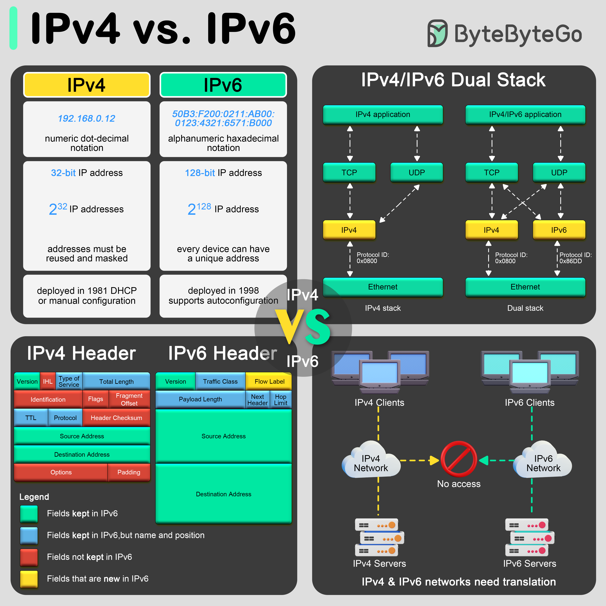

IP 負責把 packet 從一台機器送到另一台機器，但**不保證送到、不保證順序**，這些交給上面的 [TCP](/network/tcp-udp#tcp-vs-udp)。

## IPv4 vs IPv6

Internet Protocol version 4 轉移到 Internet Protocol version 6 的原因主要是我們需要更多 internet addresses 資訊。

| | IPv4 | IPv6 |
| --- | --- | --- |
| 長度 | 32 bits | 128 bits |
| 表示法 | `192.168.1.10` | `2001:db8::1`（連續的 0 可以用 `::` 省略） |
| 數量 | 約 43 億，早已不夠用 | 約 3.4 × 10³⁸，幾乎用不完 |
| 位址不夠怎麼辦 | 靠 [NAT](#nat) 讓一堆私有 IP 共用一個公有 IP | 每台裝置都能有公有位址，不需要 NAT |
| 設定 | [DHCP](#dhcp-與-slaac怎麼自動拿到-ip) 或手動 | 可以用 [SLAAC](#slaac裝置自己組) 自動產生，也能用 DHCPv6 |
| Header | fields 更複雜，長度不固定，有 checksum | fields 更簡潔，固定 40 bytes、沒有 checksum，router 處理較快 |
| 取得 MAC 位址 | [ARP](#arp從-ip-查-mac) | NDP（Neighbor Discovery） |
| Loopback | `127.0.0.1` | `::1` |



> 圖片來源：[ByteByteGo](https://blog.bytebytego.com)

兩者**不相容**，所以現在多數環境是 **dual stack**：同時配 IPv4 和 IPv6，[DNS](/network/dns) 有 `AAAA` 紀錄就優先走 IPv6。

### 現在的裝置都是 dual stack 嗎？

**現在的設備基本上都支援 dual stack**：Windows、macOS、Linux、iOS、Android 預設都同時開著 IPv4 和 IPv6。但「支援兩個」不等於「兩個都在用」，**實際走哪個要看所在的網路，而且是每條連線各自決定。**

| 網路環境 | 裝置實際用的 |
| --- | --- |
| 只有 IPv4（很多公司、舊家用路由器還是這樣） | 只用 IPv4；IPv6 那邊只有 link-local 的 `fe80::` 位址，連不了外網 |
| IPv4 + IPv6 都有（現在多數電信業者的家用寬頻） | 兩個都用，每條連線各自選 |
| 只有 IPv6（很多行動網路，例如 T-Mobile US） | 只用 IPv6；要連只有 IPv4 的網站時，由電信業者的轉換層（NAT64 / DNS64、464XLAT）代轉 |

全球來看，Google 的統計顯示大約**一半**的使用者是用 IPv6 連到 Google，另一半還在用 IPv4。

**兩個都有時怎麼選：Happy Eyeballs**

兩個都有時，OS 不是固定選一個，而是**每次連線都讓兩邊賽跑**：

```text
1. DNS 同時查 A（IPv4）和 AAAA（IPv6）
2. 先試 IPv6
3. IPv6 約 250 ms 內還沒連上，就同時開始試 IPv4
4. 誰先連上就用誰，另一條放棄
```

這叫 **Happy Eyeballs**（RFC 8305）。早期很多網路「有 IPv6 但壞掉或很慢」，如果裝置堅持走 IPv6，使用者會一直等不到畫面。用賽跑的方式，IPv6 能用就優先用，壞了也會快到使用者察覺不到地退回 IPv4。

**對後端開發的影響**

- **Apple 要求 app 必須能在純 IPv6 網路下運作**（2016 年起的 App Store 審核規定），所以 app 裡不要寫死 IPv4 位址，要用 domain name 連線。
- **服務要能被 IPv6 連到**，DNS 要有 `AAAA` 紀錄，server 也要聽 IPv6。在 Linux 上綁 `::` 通常會同時接受 IPv4 連線，這時 IPv4 的 client 會顯示成 `::ffff:1.2.3.4`（IPv4-mapped address），很方便，但記 log、做 IP 白名單時要記得處理這種格式。
- **雲端在推 IPv6**：AWS 從 2024 年起對每個公有 IPv4 收費（每個每小時約 US$0.005），所以越來越多 VPC（Virtual Private Cloud） 改成 dual stack，甚至用純 IPv6 的 subnet。
- **很多 IoT、嵌入式裝置**還是只支援 IPv4，因為網路 stack 越小越省資源。

總結：**裝置兩個都會、網路不一定兩個都給，兩個都有時由每條連線賽跑決定（通常 IPv6 勝出）。**

## 位址怎麼讀：32-bit 與 128-bit

IP 位址本質上就是一長串 0 和 1：**32-bit 是說 IPv4 位址有 32 個二進位數字，128-bit 是說 IPv6 位址有 128 個。** 一長串 0 和 1 沒人讀得懂，所以兩者用不同方式分組、換成好讀的寫法。

**IPv4：4 組 × 8 bits，用十進位寫**

```text
192      .168      .0        .12
11000000  10101000  00000000  00001100
└─ 8 bits ┘
```

- 每組 8 bits，範圍 0–255（2⁸ = 256 種）
- 4 組 × 8 bits = 32 bits，總共 2³² ≈ 43 億個位址

**IPv6：8 組 × 16 bits，用十六進位寫**

圖中的 `50B3:F200:0211:AB00:0123:4321:6571:B000` 不是 8 進位，而是 **16 進位**：8 進位只有 0–7，這裡出現 `A`–`F`（代表 10–15）。「8」是組數，不是進位制。

```text
50B3 : F200 : 0211 : AB00 : 0123 : 4321 : 6571 : B000
└ 16 bits ┘

拆開第一組 50B3：
  5      0      B      3
0101   0000   1011   0011     ← 每個 16 進位數字剛好對應 4 bits
= 0101000010110011（二進位）= 20659（十進位）
```

- 1 個 16 進位數字 = 4 bits，4 個數字一組 = 16 bits
- 8 組 × 16 bits = 128 bits
- 128 bits 用十進位寫會太長，16 進位和二進位又能直接互轉，所以 IPv6 用 16 進位

**前半是網路，後半是裝置**，和 IPv4 的 [CIDR](#cidr-與-subnet) 是同一個概念，最常見的是一半一半：

```text
50B3:F200:0211:AB00 : 0123:4321:6571:B000
└─ prefix（64 bits）─┘ └─ interface ID（64 bits）─┘
   哪個網路                那個網路裡的哪台裝置
```

所以 IPv6 一個 subnet 的標準大小是 `/64`，就像 IPv4 常見的 `/24`。

**IPv6 的兩種省略規則：**

- 每組開頭的 0 可以省略：`0211` → `211`、`0123` → `123`
- **一段**連續全為 0 的組可以合併成 `::`，整個位址只能用一次，不然無法判斷每個 `::` 各代表幾組 0

```text
2001:0db8:0000:0000:0000:0000:0000:0001
→ 2001:db8:0:0:0:0:0:1     省略開頭的 0
→ 2001:db8::1              把連續的 0 組合併成 ::
```

Loopback 的 `::1` 就是前面 127 個 0、最後一個 1。

> 2¹²⁸ 不是 2³² 的 4 倍，而是 **2⁹⁶ 倍**（約 7.9 × 10²⁸）。2¹²⁸ ≈ 3.4 × 10³⁸ 多到地球上每粒沙都能分到很多個位址，所以 IPv6 可以讓每台裝置都有公有位址，不需要 NAT。

## CIDR 與 Subnet

`10.0.1.0/24` 表示前 24 bits 是網路位址，後 8 bits 留給主機，所以這個 subnet 有 2⁸ = 256 個位址。subnet mask 就是同一件事換個寫法：`/24` = `255.255.255.0`。

| CIDR | Mask | 位址數 | 常見用途 |
| --- | --- | --- | --- |
| `/16` | `255.255.0.0` | 65,536 | 一整個 VPC |
| `/24` | `255.255.255.0` | 256 | 一個 subnet |
| `/32` | `255.255.255.255` | 1 | 指定單一台主機（例如防火牆規則） |

> 在 AWS 一個 subnet 會被保留 5 個位址（網路位址、router、DNS、保留、廣播），所以 `/24` 實際可用的是 251 個。

**私有 IP（RFC 1918）** 不會在網際網路上被路由，要出去得經過 [NAT](#nat)：

- `10.0.0.0/8`
- `172.16.0.0/12`
- `192.168.0.0/16`

## DHCP 與 SLAAC：怎麼自動拿到 IP

兩個都是在回答「裝置連上網路時，IP 怎麼自動來」：IPv4 主要靠 **DHCP**，IPv6 則有自己的 **SLAAC**。

### DHCP：由 server 分配

**DHCP（Dynamic Host Configuration Protocol）由一台 DHCP server（家裡通常就是路由器）分配 IP 給每台裝置**，順便給齊上網需要的設定：IP 與 subnet mask、default gateway（要去別的網路時交給誰）、DNS server。

流程叫 **DORA**。裝置剛連上時還沒有 IP，所以一開始只能用廣播：

```text
裝置（還沒有 IP）                    DHCP Server
  │ ── Discover（廣播）───────────▶ │   有沒有 DHCP server？
  │ ◀── Offer ───────────────────── │   你可以用 192.168.1.10
  │ ── Request（廣播）────────────▶ │   好，我要 192.168.1.10
  │ ◀── Ack ─────────────────────── │   確認，租約 24 小時
```

- 跑在 **UDP** 上（server port 67、client port 68）。
- IP 是**租的（lease）**，用到一半左右會自動續約，沒續約就收回去給別人用。
- Server 會記住哪個 MAC 拿了哪個 IP（**stateful**）。也可以設 **reservation**，讓某個 MAC 固定拿到同一個 IP，印表機、NAS 常這樣設。
- **找不到 DHCP server** 時，裝置會自己配一個 `169.254.x.x`（見[常見的特殊位址](#常見的特殊位址)）。看到 `169.254` 開頭的 IP，通常代表 DHCP 失敗了。

### SLAAC：裝置自己組

**SLAAC（Stateless Address Autoconfiguration）讓 IPv6 裝置不用別人分配，自己組出位址**，用的就是[前半網路、後半裝置](#位址怎麼讀32-bit-與-128-bit)的結構：

```text
1. 裝置送出 Router Solicitation：「這裡有 router 嗎？」
2. Router 回 Router Advertisement：「這個網路的 prefix 是 2001:db8:1:2::/64」
3. 裝置自己產生後 64 bits 的 interface ID，兩段拼起來：

   2001:db8:1:2 : 8a3f:12ff:fe4b:9c01
   └ router 給的 ┘ └ 裝置自己產生的 ┘

4. 用 NDP 確認沒有別人用這個位址（Duplicate Address Detection），就開始用
```

- **Stateless**：router 只負責廣播 prefix，不記錄誰拿了哪個位址，管理上比 DHCP 輕。
- **Interface ID 怎麼來**：早期直接從 MAC 推算（EUI-64），但這樣同一台裝置換到哪個網路都認得出來，有隱私問題，所以現在的 OS 預設**隨機產生**、而且會定期換（privacy extensions）。
- **DNS 怎麼辦**：router 可以在 Router Advertisement 裡順便帶 DNS server（RDNSS），或搭配 stateless DHCPv6 只發 DNS 設定。

| | DHCP（IPv4） | SLAAC（IPv6） |
| --- | --- | --- |
| 誰決定 IP | DHCP server 分配 | 裝置用 router 給的 prefix 自己組 |
| Server 記不記錄 | 記（stateful），知道誰拿了哪個 IP | 不記（stateless） |
| 需要專門的 server | 要（通常內建在路由器） | 不用，router 會發 RA 就好 |
| 給 DNS 設定 | 有 | 要靠 RDNSS 或 stateless DHCPv6 |

> IPv6 也有 **DHCPv6**（stateful 模式），像 DHCP 一樣由 server 分配並記錄，企業需要追蹤「哪台裝置拿了哪個 IP」時會用。但 **Android 不支援 stateful DHCPv6**，所以有手機的網路基本上一定要開 SLAAC。

## ARP：從 IP 查 MAC

**ARP（Address Resolution Protocol）在區網內把 IP 查成 MAC。** 要在區網送封包，Link 層得把它包成 frame，而 frame 上要寫**目的 MAC**；但程式只知道**目的 IP**，ARP 就是負責查「這個 IP 是哪張網卡」。

```text
192.168.1.10 想送給 192.168.1.1，但不知道它的 MAC

1. 先查本機的 ARP 快取，有就直接用
2. 沒有 → 對整個區網廣播（目的 MAC 是 ff:ff:ff:ff:ff:ff）
   「誰是 192.168.1.1？請告訴 192.168.1.10」
3. 大家都收到，但只有 192.168.1.1 回應（直接回給問的人，不是廣播）
   「192.168.1.1 在 aa:bb:cc:dd:ee:ff」
4. 存進快取（幾分鐘後過期，之後再重新查）
```

ARP 直接跑在 Ethernet 上、沒有 IP header，介於 L2 和 L3 之間，所以有時被稱為「L2.5」。

**目標不在同一個區網時，不會去查遠端 server 的 MAC。** 例如要連 `93.184.216.34`，電腦會用 subnet mask 判斷它不在本地網路，於是查的是 **default gateway（router）的 MAC**，把封包交給 router。這就是[封包怎麼跨網路送到對方](/network/protocol#封包怎麼跨網路送到對方)裡「IP 不變，MAC 每一跳都換」的原因：每一跳的 router 都會再用 ARP 查下一站的 MAC、重新包 frame。

```bash
ip neigh      # Linux
arp -a        # macOS / Windows
```

- **ARP spoofing**：ARP 完全沒有驗證，誰都可以宣稱「我就是 192.168.1.1」。攻擊者不斷送假回應，讓區網裡所有人把 gateway 的 IP 對應到攻擊者的 MAC，流量就全部經過他（中間人攻擊）。這也是為什麼在公共 Wi-Fi 一定要用 HTTPS：就算被攔截也是加密過的。企業 switch 可以開 Dynamic ARP Inspection 擋假回應。
- **Gratuitous ARP**：主動宣告自己的 IP→MAC，沒人問也送。用在 failover：例如 keepalived 的 virtual IP 漂移到備援機器時，備援機會發一個讓大家更新快取。
- **IPv6 不用 ARP**，改用 **NDP**（Neighbor Discovery，跑在 ICMPv6 上），用 multicast 取代對所有人廣播。

## NAT

**NAT（Network Address Translation）讓一整個內網的私有 IP 共用一個公有 IP 上網。** IPv4 位址早就不夠用，網際網路卻還能持續成長，靠的就是 NAT。

### 運作流程

1. 在公司或家裡，手機、電腦等多台裝置共用一台 router，而這台 router 只有**一個公有 IP**。
2. 裝置要上網時，把請求送給 router，請求的來源是裝置自己的**私有 IP**（例如 `192.168.1.10:50000`）。
3. Router 的 NAT 把來源的私有 IP **換成自己的公有 IP**（通常連 port 一起換，例如 `203.0.113.5:61000`），並把這組對應記在**轉換表**裡。
4. 改寫過的請求送上網際網路，對方只看得到 router 的公有 IP。
5. 回應回來時，NAT **查轉換表**，把目的地的公有 IP 換回正確的私有 IP，送給當初發出請求的那台裝置。

```text
內網                      NAT（家用路由器、AWS NAT Gateway）           網際網路
192.168.1.10:50000 ──▶  來源改成 203.0.113.5:61000          ──▶  93.184.216.34:443
192.168.1.10:50000 ◀──  查表改回                             ◀──  回給 203.0.113.5:61000

轉換表：203.0.113.5:61000 ↔ 192.168.1.10:50000
```

> 一個公有 IP 能分給很多台裝置，靠的是 **port**：不同裝置的連線在第 3 步會被配到不同的公有 port，回應回來時就用 port 分辨該交給誰。這種「多對一」的 NAT 也叫 **PAT**（Port Address Translation）或 NAT overload，家用路由器用的就是這種。

### NAT 的用途

- **節省公有 IP**：沒有 NAT 的話，IPv4 位址會更早用完，網際網路的成長會被嚴重限制。
- **多台裝置共用一個公有 IP**：家裡十幾台裝置、公司幾千台電腦，對外都只需要一個（或少數幾個）公有 IP。
- **基本的防火牆效果**：外部看不到內網的 IP，也無法主動連進來（見下面的影響）。但這只是 NAT 順便帶來的效果，它不會檢查流量內容，不能取代真正的防火牆或 security group。
- **網路管理更容易**：內網可以自己規劃私有 IP，不受電信業者影響。換電信業者時只有 router 的公有 IP 會變，內網設定都不用動；不同公司的內網也可以重複使用同一段私有 IP（例如都用 `10.0.0.0/8`）。

### 實務上會遇到的影響

這就是 [OSI Model](/network/protocol#osi-model) 說「L3 IP 從頭到尾不變」的例外：經過 NAT 時，來源 IP 會被換掉。

- **外面不能主動連進來**：轉換表只會因為內網主動連出去而建立，外面直接打進來查不到對應的機器。這順便擋掉了外部連線，但要讓外部連到內網的 server，得設 port forwarding 或放 load balancer。
- **Server 看到的是 NAT 的 IP**：同一個公司、甚至同一個電信業者（CGNAT）底下的大量使用者會共用同一個 IP，用 IP 做 rate limit 或封鎖時容易誤傷。真正的 client IP 要靠 proxy 帶的 `X-Forwarded-For` 之類的 header。
- **P2P 很難直連**：兩邊都在 NAT 後面時，誰都無法主動連到對方。視訊通話、線上遊戲會用 STUN 打洞，打不通再透過 TURN server 轉送（見下面的 [P2P：IPv4 + NAT vs IPv6](#p2pipv4--nat-vs-ipv6)）。
- **雲端**：AWS 的 private subnet 沒有公有 IP，要連外（例如下載套件）得經過 **NAT Gateway**；public subnet 則透過 **Internet Gateway** 把 instance 的私有 IP 一對一對應到它的公有 IP。

IPv6 位址夠多，每台裝置都能有自己的公有位址，原則上不需要 NAT，改用防火牆控制誰能連進來。

### P2P：IPv4 + NAT vs IPv6

**IPv6 讓 P2P 方便很多，但不是自動就通。** 少了 NAT 就沒有位址轉換在中間攪局，但 router 還是有防火牆、預設擋掉外部主動連入，所以還是要「打洞」，只是變得簡單又可靠。

**IPv4 + NAT 下 P2P 為什麼難**

1. **不知道自己的公有位址**：Alice 的手機只知道自己是 `192.168.1.23`，要先問外面的 **STUN server** 才知道自己對外是哪個 IP:port。
2. **Port 會被改**：有些 NAT（symmetric NAT）對每個不同的目的地都配不同的公有 port，從 STUN 問到的 port 不一定是連 Bob 時用的那個，打洞就失敗。
3. **CGNAT 更麻煩**：很多行動網路、寬頻在電信業者那端又多一層 NAT，公有 IP 根本不是你的，連 port forwarding 都設不了。
4. **最後只能繞路**：打洞失敗時，所有流量都要經過 **TURN server** 轉送，延遲變高，營運方也要付頻寬費用。

**IPv6 怎麼讓它變簡單**

```text
Alice  2001:db8:a::23 ──────────────────────── Bob  2001:db8:b::37
        └──── 裝置自己的位址就是公有位址，中間不轉換 ────┘
```

1. **自己的位址就是公有位址**：Alice 直接知道別人要用 `2001:db8:a::23` 找她，可以直接告訴 Bob，不用問 STUN。
2. **Port 不會被改**：Alice 用 50000，對方看到的就是 50000。
3. **打洞變得可靠**：router 的防火牆預設還是擋外部主動連入，但用下面的方式幾乎都能成功：

   ```text
   1. Alice 和 Bob 先透過 signaling server（例如 app 的後端）交換彼此的位址
   2. 兩邊同時送一個封包給對方
      Alice 的防火牆：「Alice 主動連出去給 Bob，所以 Bob 的回應可以進來」
      Bob 的防火牆：  「Bob 主動連出去給 Alice，所以 Alice 的回應可以進來」
   3. 兩邊的防火牆都有了對方的紀錄，直接連上
   ```

   IPv4 下這一步常因為 port 被改而失敗；IPv6 下位址和 port 都是看到的那個，所以幾乎都會成功。
4. **要架服務也簡單**：不用設 port forwarding（CGNAT 下根本設不了），只要在 router 防火牆開一條規則，讓某台裝置的某個 port 能被連（pinhole），例如允許連入 `[2001:db8:b::37]:25565`。
5. **少繞路**：直連成功率高，就很少需要 TURN，延遲低、伺服器成本也低。

| | IPv4 + NAT | IPv6 + 防火牆 |
| --- | --- | --- |
| 知道自己的公有位址 | 要問 STUN server | 自己的位址就是 |
| Port | 可能被改，甚至無法預測 | 不變 |
| 打洞 | 遇到 symmetric NAT / CGNAT 常失敗 | 幾乎都成功 |
| 架服務讓別人連 | port forwarding，CGNAT 下做不到 | 防火牆開一條規則 |
| 需要 TURN 轉送 | 常常 | 很少 |

**還是要注意**

- **兩邊都要有 IPv6**：目前大約只有一半的使用者有 IPv6，只要有一邊只有 IPv4，就還是得回到 STUN / TURN。所以 WebRTC（視訊通話用的技術）會同時收集 IPv4 和 IPv6 的候選位址，全部試過一輪。
- **位址會變**：為了隱私，裝置預設用隨機產生的臨時 IPv6 位址，而且會定期換。要架服務時要用裝置的固定位址，或用 domain name 連。
- **沒有 NAT 不等於沒有保護**：IPv6 裝置真的可以被外面直接連到，安全完全靠防火牆規則，只開需要的 port、只開給需要的裝置。

這也是為什麼 Tailscale、視訊通話這類工具在兩邊都有 IPv6 時，直連的比例會明顯變高、延遲也比較低。

## 常見的特殊位址

| 位址 | 意思 |
| --- | --- |
| `127.0.0.1` | 自己（loopback） |
| `0.0.0.0` | 沒有位址；server 綁在這上面表示「監聽所有網卡」 |
| `192.168.1.1` | 家用路由器常見的 gateway（私有 IP） |
| `255.255.255.255` | 廣播給同一個區網的所有人 |
| `8.8.8.8` | Google 的公共 DNS |
| `169.254.0.0/16` | [DHCP](#dhcp由-server-分配) 失敗時自動配的位址（APIPA / link-local）；雲端的 metadata server `169.254.169.254` 也在這段 |
| `224.0.0.0/4` | [Multicast](/network/tcp-udp#multicast--broadcast) 位址範圍，例如 `224.0.0.1` 是「本網段所有主機」 |

> 寫 server 時綁 `127.0.0.1` 只有本機連得到；放進 container 裡要讓外面連，得綁 `0.0.0.0`。
