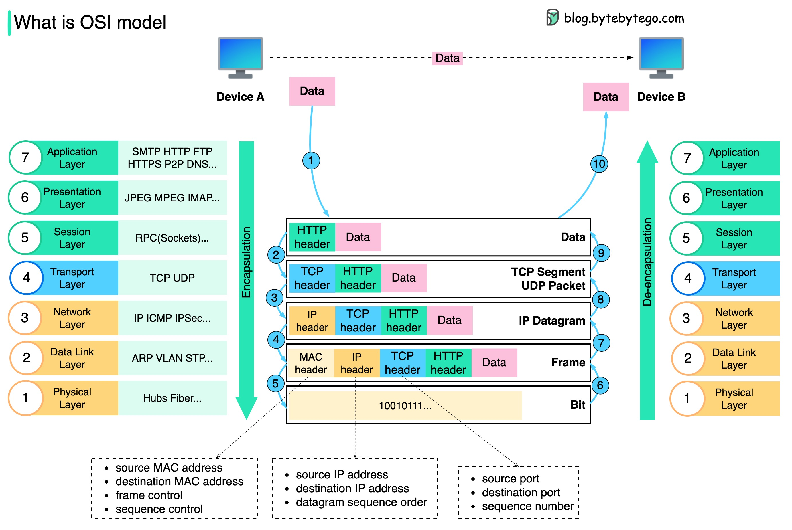

import networkMeme from './network-meme.jpg';


**在瀏覽器輸入一個網址按下 Enter，背後依序會用到：DNS 把名字換成 IP、TCP 建立連線、（TLS 加密）、HTTP 送出請求。** 這頁講網路範圍和分層模型（OSI、TCP/IP），[IP](/network/ip)（IPv4 / IPv6、CIDR、DHCP、ARP、NAT）和 [TCP vs UDP 與常見協定](/network/tcp-udp) 另外拆成分頁，應用層的協定也各有分頁：[DNS](/network/dns)、[HTTP](/network/http)、[HTTPS / SSL / TLS](/network/security)。

```text
https://api.example.com/books/42
   │
   ├─ 1. DNS：api.example.com → 93.184.216.34
   ├─ 2. TCP：三次握手連到 93.184.216.34:443
   ├─ 3. TLS：交換憑證與金鑰（見 HTTPS / SSL / TLS）
   └─ 4. HTTP：GET /books/42 → 200 OK
```

## 網路的範圍：PAN、LAN、MAN、WAN

依照涵蓋的範圍，網路由小到大分成四種：

| 類型 | 全名 | 範圍 | 例子 | 常見技術 |
| --- | --- | --- | --- | --- |
| **PAN** | Personal Area Network | 一個人身邊幾公尺內 | 手機連藍牙耳機、Apple Watch | Bluetooth、USB、NFC |
| **LAN** | Local Area Network | 一個家、一間辦公室、一棟建築 | 家裡的 Wi-Fi、公司內網 | Ethernet、Wi-Fi，用 switch 串起來 |
| **MAN** | Metropolitan Area Network | 一座城市、相鄰的幾個園區 | 大學多個校區互連、城市的光纖網路 | 光纖、Metro Ethernet |
| **WAN** | Wide Area Network | 跨城市、跨國家 | 網際網路、企業總部連分公司 | 光纖骨幹、MPLS、VPN、SD-WAN，用 router 串起來 |

- **網際網路就是最大的 WAN**，由無數個 LAN 透過 [router](#router-是什麼) 連在一起。
- 本頁常說的「**區網**」就是 LAN：[ARP](/network/ip#arp從-ip-查-mac) 的廣播、[MAC](#osi-model) 位址都只在同一個 LAN 內有效，出了 LAN 就要交給 router。
- 家用路由器背後會看到 **WAN port**（接電信業者的線，拿到公有 IP）和 **LAN port**（接家裡的裝置，發私有 IP），中間就是 [NAT](/network/ip#nat) 在轉換。
- 雲端的 VPC 可以想成雲上的 LAN；公司機房透過 VPN 或專線（如 AWS Direct Connect）連到 VPC，走的就是 WAN。

## OSI Model

OSI 把網路通訊切成 7 層，每層只跟上下層打交道：上層把資料交給下層時會**加上自己的 header（封裝）**，對方收到後由下往上一層層拆掉。實務上用的是比較簡化的 [TCP/IP 四層模型](#tcpip-model)，但面試和除錯時大家還是習慣用 OSI 的層號講話（「L4 load balancer」、「L7 proxy」）。

| OSI 層 | 名稱 | TCP/IP 層 | 資料單位 | 協定 / 例子 | 設備 |
| --- | --- | --- | --- | --- | --- |
| 7 | Application（應用層） | Application | Data | HTTP、DNS、SMTP、SSH | L7 load balancer、API Gateway |
| 6 | Presentation（表現層） | Application | Data | TLS、編碼、壓縮 | |
| 5 | Session（會話層） | Application | Data | 連線的建立與維持 | |
| 4 | Transport（傳輸層） | Transport | Segment / Datagram | TCP、UDP | L4 load balancer |
| 3 | Network（網路層） | Internet | Packet | IP、ICMP | [Router](#router-是什麼) |
| 2 | Data Link（資料連結層） | Link | Frame | Ethernet、Wi-Fi、ARP | Switch |
| 1 | Physical（實體層） | Link | Bit | 網路線、光纖、電波 | Hub、網卡 |




> 圖片來源：[ByteByteGo](https://blog.bytebytego.com)
>
> 接收端跟發送端是兩個不同 device，可能單純傳一個 data 溝通這樣。

1. 當設備 A 要傳送 `DATA` 給設備 B，他如果要使用 HTTP protocol，首先需要加上 HTTP header
2. 接下來根據傳輸協議的決定加上 TCP 或 UDP header，成為 `TCP Segment`/`UDP Packet`，會包含 source port、destination port 和 sequence number
3. 再來，會在網路層加上 IP header，成為 `IP Datagram`，包含了 source 和 destination IP addresses
4. 在資料連接層加上 MAC header，成為 `Frame`，包含了 source 和 destination MAC addresses
   - **MAC address** 是每張網卡出廠時就燒進去的 48-bit 硬體位址，寫成 `00:1A:2B:3C:4D:5E`，前 24 bits 代表製造商。
   - 它只在**同一個區網內**有意義：IP 是最終的收件地址，MAC 是「這一站要交給隔壁哪台機器」，所以每經過一個 router 就會換一次。
   - 知道對方 IP 但不知道 MAC 時，會用 **[ARP](/network/ip#arp從-ip-查-mac)** 在區網裡廣播「誰是 `192.168.1.1`？」，對方回自己的 MAC。`ip neigh`（或 `arp -a`）可以看本機快取的對照表。
5. 這整個包裝起來的訊息會透過物理層傳輸（以 `binary bits` 形式） 
6. 接下來會反過來一一拆解，知道要送到哪個設備、哪個 IP、最後是哪個程式，如何呈現等

```text
發送端                                          接收端
[HTTP data]                                     [HTTP data]
[TCP hdr][HTTP data]                            ▲ 拆 TCP header
[IP hdr][TCP hdr][HTTP data]                    ▲ 拆 IP header
[Eth hdr][IP hdr][TCP hdr][HTTP data][Eth trl]  ▲ 拆 Ethernet frame
        ──────────── 實體線路 ────────────▶
```

**每一層各自負責「送到哪」：**

- **L2 MAC address**：同一個區網內，下一跳是哪張網卡。每經過一個 router 就會換掉。
- **L3 IP address**：整條路的起點與終點，從頭到尾不變（不考慮 [NAT](/network/ip#nat)）。
- **L4 port**：送到那台機器上的哪個 process，例如 `:443` 是 HTTPS、`:5432` 是 PostgreSQL（見[常見的 Port](/network/tcp-udp#常見的-port)）。

所以「L4 load balancer」只看 IP 和 port 就轉發，速度快但看不懂內容；「L7 load balancer」會拆開 HTTP，可以依 path、header、cookie 分流（見 [Proxy](/backend/proxy)）。

## TCP/IP Model

**OSI 是教科書上的參考模型，TCP/IP 才是網際網路實際在跑的協定組（protocol suite）。** 名字取自其中最核心的兩個協定 TCP 和 IP，但它包含的是一整組協定。OSI 當年規劃的那套協定幾乎沒人用，最後留下來的只有它的分層概念和層號。

TCP/IP 把 OSI 的 5–7 層併成一個 Application 層，1–2 層併成一個 Link 層：

| TCP/IP 層 | 對應 OSI | 負責什麼 | 協定 | 在哪裡實作 |
| --- | --- | --- | --- | --- |
| Application | 5–7 | 應用程式之間要講什麼 | HTTP、DNS、TLS、SSH、SMTP | 你的程式（user space） |
| Transport | 4 | process 對 process：port、可靠性、流量控制 | TCP、UDP、QUIC* | OS kernel |
| Internet | 3 | 主機對主機：定址與跨網路路由 | IP、ICMP | OS kernel |
| Link | 1–2 | 同一段網路內，相鄰兩台機器之間怎麼送 | Ethernet、Wi-Fi、ARP | 網卡 driver 與硬體 |

> \* QUIC 實際上跑在 UDP 之上、在 user space 實作，但它做的是傳輸層的工作（連線、可靠性、壅塞控制）。
>
> 有些教科書（例如 Kurose 的《Computer Networking》）會把 Link 再拆成 Data Link 和 Physical，變成 **五層模型**。

### Socket：程式和 kernel 的分界

寫程式時你只碰得到 Application 層。Transport 以下都在 kernel 裡，中間的介面就是 **socket**：

```text
你的程式   conn.Write([]byte("GET / HTTP/1.1 ..."))
──────────────── socket API（send / recv）────────────────
kernel     TCP：切成 segment、編序號、等 ACK、重傳
           IP ：加上來源 / 目的 IP，查 routing table
driver     Ethernet：查 ARP 拿到下一跳的 MAC，包成 frame
──────────────────────────────────────────────────────────
網卡       送上線路
```

所以程式只要說「送這些 bytes 到 `93.184.216.34:443`」，握手、重傳、路由都不用管。`ss -tan`、`netstat` 看到的連線狀態，就是 kernel 裡 TCP 層的狀態。

### Router 是什麼

**Router（路由器）負責把封包從一個網路送到另一個網路。** 它同時接著好幾個網路（每個介面接一個），收到封包後拆到 L3 看**目的 IP**，查自己的 **routing table（路由表）** 決定下一站要交給誰，再從對應的介面送出去。

最容易和它搞混的是 switch：

| | Switch（交換器） | Router（路由器） |
| --- | --- | --- |
| 工作在哪一層 | L2（Link） | L3（Network / Internet） |
| 看封包的什麼 | 目的 **MAC** | 目的 **IP** |
| 負責範圍 | **同一個** LAN 內的裝置互傳 | **不同**網路之間 |
| 查的表 | MAC 位址表（哪個 MAC 在哪個 port） | Routing table（哪個網路往哪裡送） |
| 廣播 | 會轉給同一個 LAN 的所有人 | 不轉送，廣播就停在 LAN 的邊界 |

一台家用 router 的 routing table 大概長這樣：

```text
目的網路            下一站（next hop）      從哪個介面送出
192.168.1.0/24      直接送（就是本地網路）   LAN
0.0.0.0/0           電信業者的 router        WAN    ← default route：其他不認得的全部往這丟
```

- 查表時會選**最具體（prefix 最長）**的那條：`192.168.1.37` 同時符合 `/24` 和 `/0`，選 `/24`，直接在區網送；`142.250.1.1` 只符合 `/0`，就交給電信業者。
- 你電腦設定裡的 **default gateway**，就是「不在本地網路的封包都交給它」的那台 router。在電腦上用 `ip route`（Linux）或 `netstat -rn`（macOS）可以看到自己的 routing table。
- 網際網路上的 router 之間，會用 **BGP** 互相交換「哪些網路可以從我這裡到」，各家電信業者、雲端業者就是這樣把整個網際網路串起來的。

> 家裡那台「Wi-Fi 分享器 / 路由器」其實是 router、switch、Wi-Fi 基地台、NAT、DHCP server 合體，見最後的[綜合例子](#綜合例子合租公寓共用一台-wi-fi)。

### 封包怎麼跨網路送到對方

不是每台設備都要處理全部四層：**終端主機**四層都有，**router** 只拆到 Internet 層看目的 IP，**switch** 只看到 Link 層的 MAC。

```text
  Client          Router A         Router B         Server
  Application                                       Application
  Transport                                         Transport
  Internet ──────▶ Internet ──────▶ Internet ──────▶ Internet
  Link             Link             Link             Link
         MAC: C→A          MAC: A→B         MAC: B→S
         IP : C→S          IP : C→S         IP : C→S    ← IP 不變，MAC 每一跳都換
```

每經過一個 router，IP header 的 **TTL 減 1**，減到 0 就丟掉並回一個 ICMP 錯誤，避免封包在迴圈裡永遠轉下去。`traceroute` 就是利用這點：依序送出 TTL = 1、2、3… 的封包，看每一跳是哪台 router 回的。

### MTU 與 MSS

Link 層一次能送的大小有上限，叫 **MTU**（Ethernet 是 1500 bytes）。扣掉 IP header（20）和 TCP header（20），TCP 每個 segment 最多帶 **MSS = 1460 bytes** 的資料，大於這個的資料 TCP 會自己切。

```text
|←───────────────── MTU 1500 ─────────────────→|
[IP hdr 20][TCP hdr 20][      data ≤ 1460      ]
```

> 走 VPN、VXLAN 等 tunnel 時會多包一層 header，可用的 MTU 變小。如果路上有設備擋掉 ICMP，「封包太大」的通知傳不回來，就會出現**小請求正常、大請求卡住**的怪問題，這通常就是 MTU 不一致。

## 綜合例子：合租公寓共用一台 Wi-Fi

把這頁和 [IP](/network/ip)、[TCP vs UDP](/network/tcp-udp) 的東西串起來：一間合租公寓（或小辦公室）只有一台 Wi-Fi 機，Alice 的手機和 Bob 的筆電都連在上面。

### 那台「Wi-Fi 機」其實是好幾台設備合體

| 角色 | 做什麼 | 對應小節 |
| --- | --- | --- |
| Wi-Fi 基地台（Access Point） | 讓無線裝置加入區網 | [LAN](#網路的範圍panlanmanwan)、L1/L2 |
| Switch | 區網內的裝置之間，靠 MAC 轉送 frame | [MAC](#osi-model)、[ARP](/network/ip#arp從-ip-查-mac) |
| Router | 把要出去的封包交給電信業者 | [封包怎麼跨網路](#封包怎麼跨網路送到對方) |
| NAT | 一堆私有 IP 共用一個公有 IP | [NAT](/network/ip#nat) |
| DHCP server | 發 IP 給大家 | [DHCP](/network/ip#dhcp由-server-分配) |
| DNS 轉發 | 把 DNS 查詢轉給電信業者或 8.8.8.8 | [DNS](/network/dns) |
| 防火牆 | 預設擋掉外部主動連入 | [NAT](/network/ip#實務上會遇到的影響)、[IPv6](/network/ip#p2pipv4--nat-vs-ipv6) |

Router 有兩面：**WAN 那面**從電信業者拿到一個公有 IP（例如 `203.0.113.5`），**LAN 那面**是公寓自己的區網 `192.168.1.0/24`。

### 1. 連上 Wi-Fi（L1/L2）

Alice 輸入 Wi-Fi 密碼，手機和 router 完成 WPA2 / WPA3 認證，手機就**加入了區網（LAN）**。這時它只有 MAC 位址，還沒有 IP。

### 2. 拿到 IP（DHCP，以及 SLAAC）

```text
Alice 手機 ── Discover（廣播）──▶ Router：有 DHCP server 嗎？
          ◀── Offer ─────────────── 你用 192.168.1.23
          ── Request ─────────────▶ 好，我要
          ◀── Ack ───────────────── 租 24 小時；gateway 和 DNS 都是 192.168.1.1
```

Bob 的筆電一樣走一遍，拿到 `192.168.1.37`。現在公寓裡每個人都在同一個區網，各有一個私有 IP。如果電信業者有給 IPv6，router 還會廣播一個 /64 prefix，每台裝置用 SLAAC 自己組出**公有的 IPv6 位址**，走 IPv6 時就完全沒有 NAT。

### 3. Alice 打開 `https://youtube.com`

1. **DNS**：手機問 `192.168.1.1`「youtube.com 的 IP 是多少」（UDP 53），router 轉問電信業者的 DNS，拿到 A / AAAA 紀錄。假設最後走 IPv4：`142.250.1.1`。
2. **判斷要交給誰**：手機用 subnet mask `/24` 發現 `142.250.1.1` 不在本地網路，所以要交給 **default gateway** `192.168.1.1`。
3. **ARP**：手機還不知道 router 的 MAC，廣播「誰是 192.168.1.1？」，router 回自己的 MAC。
4. **包封包**：

   ```text
   [MAC: Alice → Router][IP: 192.168.1.23 → 142.250.1.1][TCP: 51000 → 443][TLS 加密的 HTTP]
   ```

5. **NAT**：封包經過 router 出去時，來源被改掉，並記進轉換表：

   ```text
   192.168.1.23:51000  →  203.0.113.5:61001
   ```

6. **穿過網際網路**：經過一堆 router，每一跳 **MAC 換掉、TTL 減 1**，**IP 不變**。YouTube 看到的只有 `203.0.113.5`。
7. **建立連線**：TCP 三次握手 → TLS 握手 → HTTP 請求。兩邊都支援 HTTP/3 的話，改走 UDP 443（QUIC）。
8. **回應回來**：送到 `203.0.113.5:61001`，NAT 查表換回 `192.168.1.23:51000`，router 用 ARP 快取找到 Alice 的 MAC，透過 Wi-Fi 送給她的手機。

### 4. Bob 同時也在看 YouTube

```text
Alice：192.168.1.23:51000  →  203.0.113.5:61001
Bob  ：192.168.1.37:51000  →  203.0.113.5:61002   ← 同一個公有 IP，用公有 port 區分
```

就算兩人本地都用 51000，NAT 也會配不同的公有 port，回應回來時靠 port 分辨該給誰，這就是 **PAT**。

### 從協定看合租會遇到的事

- **頻寬是共用的**：大家共用 router 到電信業者的那一條線，一個室友在下載大檔，所有人都會變慢。Wi-Fi 本身也是共享的空間，裝置越多越要搶時間發送。
- **對外大家都是同一個人**：網站只看到 `203.0.113.5`，一個室友的行為觸發了 rate limit、封鎖或 Google 驗證碼，所有人都會中。
- **大家在同一個區網**：可以看到彼此的印表機、Chromecast（靠 multicast 互相發現）；也代表惡意的室友理論上能用 [ARP spoofing](/network/ip#arp從-ip-查-mac) 攔截流量。HTTPS 能保護內容不被看到，但管理 router 的人還是看得到你查了哪些網域。很多 router 有**訪客網路或 client isolation**，可以把裝置隔開。
- **外面預設連不進來**：想在房間架遊戲 server、從外面連回自己電腦，得在 router 設 **port forwarding**，例如把公有的 25565 轉給 `192.168.1.37:25565`。
- **IPv6 不一樣**：每台裝置都有自己的公有 IPv6 位址，外面的網站分得出 Alice 和 Bob；擋外部連入的是 router 的防火牆，不是 NAT。

> **小辦公室**的流程完全一樣，只是規模變大：設備會拆開（獨立的 router、managed switch、多台 AP），用 **VLAN** 把員工、訪客、伺服器切成不同區網；Wi-Fi 常用 WPA2/3-Enterprise，每個人用自己的帳號登入，而不是共用一組密碼；也會有內部 DNS，讓 `nas.office.local` 這種名字指到內網的機器。

