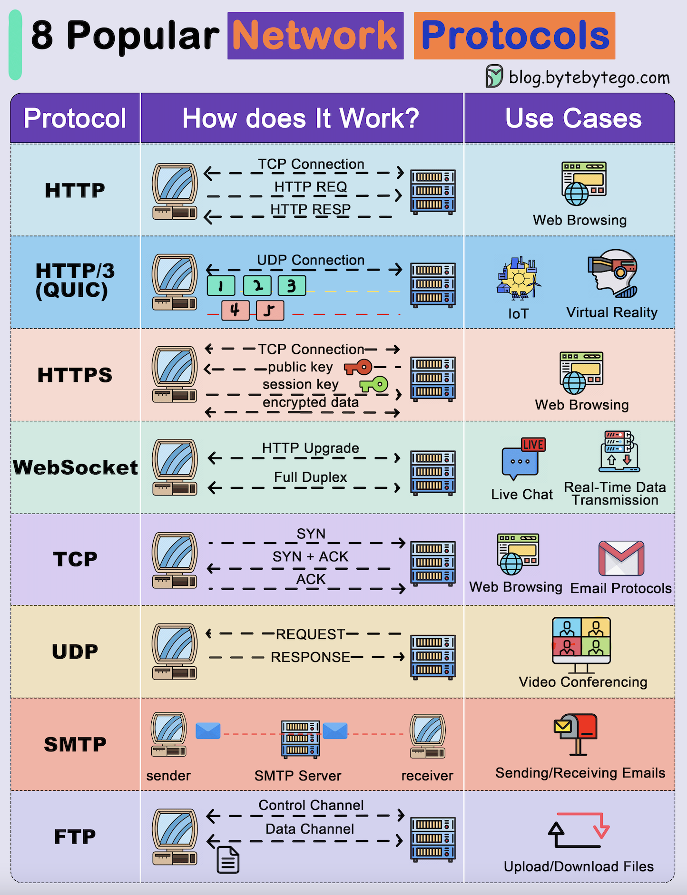

## TCP vs UDP

兩個都在 [L4（傳輸層）](/network/protocol#tcpip-model)，差別是 **TCP 幫你保證可靠，UDP 只管丟出去**。

| | TCP | UDP |
| --- | --- | --- |
| 連線 | 要先握手建立連線 | 不用，直接送 |
| 可靠性 | 保證送達、不重複、照順序 | 可能遺失、重複、亂序 |
| 如果失敗，重送 | 可 | 不可 |
| 資料型態 | Byte stream（沒有訊息邊界） | Datagram（一次送一個完整訊息） |
| 流量控制 / 壅塞控制 | 有 | 沒有 |
| Header | 20–60 bytes | 8 bytes |
| Broadcasting | 不可 | 可 |
| 速度 / 延遲 | 較慢，遺失要重傳 | 較快 |
| 用在 | HTTP/1.1、HTTP/2、SSH、資料庫連線、email or texting、File transfers、Web browsing | DNS 查詢（預設用 UDP port 53）、IoT、影音串流、視訊通話、線上遊戲、QUIC（HTTP/3） |

**怎麼選：** 資料**一個 byte 都不能錯**就用 TCP；**晚到的資料等於沒用**（視訊畫面、遊戲座標）就用 UDP，掉了直接用下一筆。

> Streaming pre-recorded content on sites like Netflix, Hulu, or HBO Max use **TCP**

### 三次握手（建立連線）

```text
Client                          Server
  │ ── SYN (seq=x) ──────────────▶ │   我想連線
  │ ◀── SYN-ACK (seq=y, ack=x+1) ─ │   好，我也想
  │ ── ACK (ack=y+1) ────────────▶ │   收到，開始傳
  │ ═══════════ 傳資料 ═══════════ │
```

為什麼是三次不是兩次？雙方都要確認**自己送得出去、也收得到對方的**，並交換各自的起始序號（seq）。只有兩次的話，server 無法確認 client 收到了它的 SYN；網路上殘留的舊 SYN 也可能讓 server 白白開一條連線。

> 之後 kernel 會一直記著這條連線的狀態，直到四次揮手關閉。

### 四次揮手（關閉連線）

```text
Client                          Server
  │ ── FIN ──────────────────────▶ │   我沒有要送的了
  │ ◀── ACK ────────────────────── │   知道了（但我可能還有資料要送）
  │ ◀── FIN ────────────────────── │   我也送完了
  │ ── ACK ──────────────────────▶ │
  │  TIME_WAIT（等 2×MSL 才真正關閉）
```

比握手多一次，是因為 TCP 是**雙向**的，兩個方向要各自關閉；server 收到 FIN 時可能還有資料沒送完，所以 ACK 和 FIN 分開送。

> 實務上常見的問題：大量短連線會讓主動關閉的一方堆積 `TIME_WAIT`，把 port 用光。解法通常是**重用連線**（HTTP keep-alive、connection pool），而不是去調 kernel 參數。用 `ss -tan` 可以看各狀態的連線數（見 [Commands](/os/linux/commands)）。

### TCP 怎麼保證可靠

- **序號（seq）與 ACK**：每個 byte 都有編號，收到的一方回 ACK 告訴對方「下一個我要第幾號」，所以能重組順序、丟掉重複。
- **重傳**：等不到 ACK（timeout）或連續收到 3 個重複的 ACK，就重送。
- **Flow control（流量控制）**：接收端用 window size 告訴對方「我的 buffer 還剩多少」，避免把接收端塞爆。
- **Congestion control（壅塞控制）**：發送端從小量開始送（slow start），沒掉封包就加速，掉了就減速，避免把整個網路塞爆。
- **檢查錯誤**：確保資料沒被改動，每個 segment 都有 checksum，壞掉的直接丟掉，再靠重傳補回來。補充：這個 checksum 很弱，只能抓到傳輸中意外出錯，擋不住有人故意竄改。要防竄改得靠 TLS。

相對的 UDP：
- 能承受掉封包：精確地說，是 UDP 不在乎掉封包，交給 app 自己決定。視訊通話掉了一格畫面就直接跳過，不會卡住等它補回來。
- 封包小、開銷少，延遲較低：header 只有 8 bytes。但延遲低的主因其實不是 header 小，而是不用等 ACK、不用等重傳、沒有 head-of-line blocking，後面的資料不會被前面掉的那個卡住。
- **檢查錯誤**：UDP 有 checksum（在 IPv4 是選用，在 IPv6 是必填），壞掉的封包會被丟掉，所以 app 收到的資料是完好的。真正不知道的是有沒有送到。
- **沒有壅塞控制**：UDP 不會因為網路塞車而降速，猛送的 UDP 流量會搶走頻寬，讓同一條線上的 TCP 連線被迫降速。所以認真的 UDP 應用都會自己做壅塞控制，QUIC 和 WebRTC 都有。
- **常被防火牆擋**：很多公司、學校、飯店的網路只放行 TCP 80 / 443。所以 HTTP/3（QUIC）連不上時，瀏覽器會自動退回 TCP 的 HTTP/2。

### Head-of-line blocking

TCP 保證順序，代價是**前面一個封包掉了，後面已經到的也得等它重傳**（掉一個封包會卡住後面的資料）。這就是 HTTP/2 在差的網路下反而可能比較慢、HTTP/3 改用 UDP（QUIC）的原因，見 [HTTP 版本演進](/network/http#版本演進)。

### 為什麼 TCP 一開始特別慢

一條新的 TCP 連線，前面幾個來回都在「暖機」：

1. **握手要先花時間**：三次握手至少多一個 RTT（封包來回一趟的時間），之後再做 TLS 握手又要 1–2 個 RTT，這段時間一個 byte 的資料都還沒送。
2. **Slow start**：連線剛建立時，發送端不知道網路能承受多少，只敢先送一點（現在的 Linux 預設約 10 個 segment，大約 14 KB）。每收到一輪 ACK 就加倍，掉封包才停止加速。

```text
RTT 1：握手
RTT 2：TLS 握手（TLS 1.3）
RTT 3：送  14 KB
RTT 4：送  28 KB
RTT 5：送  56 KB   ← 越送越快，但短連線常常還沒加速完就結束了
```

所以大量「開一條連線、送一點點、就關掉」的請求特別吃虧。常見的解法：

- **重用連線**：HTTP keep-alive、connection pool，讓後面的請求直接用已經暖好的連線。
- **少一點握手**：TLS 1.3 只要 1 RTT，QUIC 把傳輸層和 TLS 的握手合在一起，連過的 server 甚至可以 0-RTT 直接送資料。
- **CDN**：把 server 放到離使用者近的地方，RTT 變短，每個來回都變快。

### Multicast / Broadcast

依「誰會收到」，傳送方式分成四種：

| 方式 | 誰收到 | 比喻 | 例子 |
| --- | --- | --- | --- |
| **Unicast（單播）** | 指定的一台 | 打電話給一個人 | 一般上網、API 請求，絕大多數流量都是這種 |
| **Broadcast（廣播）** | 同一個區網的**所有人**，不管要不要 | 大樓廣播，每戶都聽得到 | [ARP](/network/ip#arp從-ip-查-mac)、[DHCP](/network/ip#dhcp由-server-分配) Discover |
| **Multicast（群播）** | 有**加入群組**的那些人 | 訂閱某個廣播電台頻道，有調到的才聽得到 | mDNS、IPTV、股票行情 |
| **Anycast** | 一群機器中**離你最近**的一台 | 打客服專線，自動轉到最近的據點 | `8.8.8.8`、`1.1.1.1`、CDN |

Multicast 的好處是：要把同一份資料送給 1000 個人時，**發送端只送一次**，由網路設備在分岔的地方複製封包，而不是自己送 1000 份。

```text
Unicast：發送端送 3 份            Multicast：發送端只送 1 份
  Server ──▶ A                     Server ──▶ Router ──┬──▶ A
  Server ──▶ B                                         ├──▶ B
  Server ──▶ C                                         └──▶ C
                                              （router 在分岔處複製）
```

#### 為什麼只能用 UDP

TCP 不能 multicast / broadcast：TCP 是一對一的連線，要握手、要回 ACK，沒辦法同時對很多人送。如果 1000 個接收者都對發送端回 ACK，發送端會被淹沒（**ACK implosion**），「誰掉了就補誰」也沒辦法套在一份共用的封包上。所以 DHCP、mDNS 這類要廣播或群播的協定都用 UDP，可靠性要另外處理，例如接收端自己補洞，或加上冗餘資料。

#### Multicast 怎麼運作

1. **群組就是一個特殊 IP 位址**：IPv4 的 `224.0.0.0/4`（224.x.x.x – 239.x.x.x）專門給 multicast 用（見[常見的特殊位址](/network/ip#常見的特殊位址)）。這種位址不代表某一台機器，而是代表「一個頻道」。
2. **想收的裝置要先加入**：裝置用 **IGMP**（IPv6 用 MLD）告訴 router「我要收 `239.1.1.1` 這個群組」。
3. **網路設備只送給有加入的**：switch 會偷聽 IGMP 訊息（**IGMP snooping**），只把群播封包送到有人訂閱的 port。跨網路時，router 之間用 **PIM** 協定建出一棵轉送樹。
4. **發送端只管送**：發送端把封包的目的地設成群組位址就好，它不知道、也不需要知道誰在收。

#### 用在哪

UDP 一次送出就能讓很多台收到：

- **區網裡的自動發現**：**mDNS**（`224.0.0.251`）讓 Mac 找到 AirPrint 印表機、手機找到 Chromecast，不用知道對方的 IP。
- **IPv6 全面用 multicast 取代 broadcast**：IPv6 根本沒有 broadcast。像 NDP 查 MAC 時只送給相關的群組，其他裝置不會被打擾，比 ARP 對所有人廣播省事。
- **Routing 協定**：OSPF 用 `224.0.0.5` 跟同一網段的 router 交換路由資訊。
- **電信業者的 IPTV**：例如中華電信 MOD，同一個頻道只在業者的網路裡送一份，各家機上盒訂閱同一個群組。
- **金融交易所**：股票行情用 multicast 同時發給所有券商，大家幾乎同一時間收到，誰也不會比誰早。

#### 為什麼網際網路上幾乎看不到

Multicast 在公開的網際網路上基本上不會被轉送，多半只在「自己管得到的網路」裡用，像區網、公司內網、電信業者自己的網路（例如 IPTV）。各家業者的 router 之間不轉送 multicast，原因包括：每個群組都要在沿路所有 router 上維護狀態，很難管理，也很難計費和防濫用。

所以 YouTube、Twitch 的直播雖然是「一份內容給很多人」，實際上是用 **CDN 做很多份 unicast**：在世界各地放 edge server，每個觀眾從最近的節點各拿一份。

### VPN

VPN 跑在 UDP 上，例如 WireGuard 只支援 UDP，OpenVPN 預設也用 UDP。原因不只是速度：

VPN 隧道裡跑的通常本來就是 TCP 流量，裡面那層會自己負責可靠性，所以外層用不可靠的 UDP 也沒關係。

如果外層也用 TCP（TCP over TCP），一掉封包裡外兩層會同時重傳、同時降速，互相干擾，連線會越來越慢，這叫 TCP meltdown。

### UDP 放大攻擊

UDP 不用握手，server 收到請求就直接回，**也不會確認來源 IP 是不是真的**。攻擊者就利用這點做 DDoS：

```text
攻擊者 ── 小請求（來源 IP 偽造成受害者）──▶ 公開的 DNS / NTP / Memcached server
受害者 ◀── 大很多倍的回應 ────────────────── server 照著來源 IP 回
```

- **放大倍數**：DNS 約幾十倍，NTP 的 `monlist` 可以到幾百倍，Memcached 甚至上萬倍。攻擊者用很少的頻寬，就能把受害者的線路塞爆。
- **TCP 比較不會被這樣利用**：TCP 要先三次握手，偽造來源 IP 的一方收不到 SYN-ACK，連線建不起來，自然也拿不到大回應。
- **自己架服務時**：不要讓 DNS resolver、NTP、Memcached 對整個網際網路開放，只開給需要的內網或特定來源。

> UDP 就是在 IP 上面只加了 port 和 checksum 的薄薄一層，可靠性、順序、壅塞控制全部交給 app 自己決定要不要做。QUIC 就是「在 UDP 上自己做一套更好的 TCP」的例子。

## 常見網路協定一覽

TCP 和 UDP 是傳輸層的兩條路，日常用到的應用層協定大多就蓋在它們上面：



> 圖片來源：[ByteByteGo](https://blog.bytebytego.com)

1. **HTTP**：client-server 的請求-回應協定，用來抓 HTML、圖片、API 資料等資源，是 Web 資料交換的基礎。跑在 TCP 上（見 [HTTP](/network/http)）。
2. **HTTP/3**：HTTP 的下一個主要版本，改跑在 **QUIC（UDP）** 上，一個 stream 掉封包不會卡住其他 stream，連線建立也更快。很適合常換網路的行動裝置，以及 VR 這類需要大量頻寬、對延遲敏感的應用（見 [HTTP 版本演進](/network/http#版本演進)）。
3. **HTTPS**：HTTP 加上 TLS 加密，先用公鑰交換出 session key，之後的資料都用它加密（見 [HTTPS / SSL / TLS](/network/security)）。
4. **WebSocket**：在一條 TCP 連線上做**全雙工**通訊。先用 HTTP 的 `Upgrade` header 握手，server 回 `101 Switching Protocols` 後，這條連線就改講 WebSocket。REST 只能由 client 主動「拉」資料，WebSocket 讓 server 也能主動「推」，適合聊天、股價、線上遊戲這類即時更新。
5. **TCP**：先三次握手建立連線，保證資料送達且照順序，許多應用層協定都蓋在它上面（見上面的 [TCP vs UDP](#tcp-vs-udp)）。
6. **UDP**：不建立連線，直接把封包丟給對方。適合「偶爾掉一個封包比等它重傳好」的場景，例如語音、視訊通話。
7. **SMTP**：在 mail server 之間**寄送** email（port 25；client 送信給自己的 mail server 用 587）。收信則是另外的 IMAP / POP3。
8. **FTP**：在 client 和 server 之間傳檔案，特別的是它把**控制通道**（port 21，送指令）和**資料通道**（送檔案內容）分成兩條連線。FTP 是明文傳輸，現在多改用 SFTP（走 SSH）或 FTPS。

### 常見的 Port

**IP 找到哪台機器，port 找到那台機器上的哪個程式。** 一台 server 上可能同時跑著網頁、SSH、資料庫，封包到了這台機器後，就是靠 TCP / UDP header 裡的目的 port 決定交給誰（見 [OSI Model](/network/protocol#osi-model) 的 L4 port）。可以想成 IP 是大樓地址、port 是房號。

Port 是 16-bit 的數字，範圍 0–65535。實際使用上分成兩邊：

```text
Server：程式啟動時「聽（listen）」一個固定 port，等別人連進來
        nginx 聽 443、PostgreSQL 聽 5432
Client：連線時指定「目的 IP:port」，自己這端由 OS 隨機配一個 port
        192.168.1.10:52344  ──▶  93.184.216.34:443
```

所謂**常見 port（預設 port）**，就是大家約定好「這種服務通常聽這個 port」，所以 client 不用每次都問。例如瀏覽器打 `https://example.com` 時其實是連 `example.com:443`，因為 443 是 HTTPS 的預設 port，網址裡可以省略；服務不是聽預設 port 時就要寫出來，例如開發時的 `http://localhost:3000`。

日常會用到 port 的地方：

| 情境 | 例子 |
| --- | --- |
| 網址、連線字串 | `http://localhost:3000`、`postgres://db.internal:5432/app` |
| 查誰佔用了某個 port | `lsof -i :3000`（macOS）、`ss -tlnp`（Linux，列出所有在 listen 的 port） |
| 測試某個 port 通不通 | `nc -vz db.internal 5432` |
| Docker 把 container 的 port 對到主機 | `docker run -p 8080:80 nginx`：主機的 8080 → container 的 80 |
| 防火牆、AWS security group | 只開放 443 給外部，5432 只允許內網連 |

> 啟動服務時看到 `address already in use`，就是那個 port 已經有別的程式在聽了：用上面的指令找出是誰，關掉它或換一個 port。

這些是常見服務的預設 port：

| Port | 協定 | 傳輸層 | 用途 |
| --- | --- | --- | --- |
| 21 | FTP | TCP | 檔案傳輸（控制通道） |
| 22 | SSH | TCP | 加密的遠端登入，SFTP 也走這裡 |
| 23 | Telnet | TCP | 遠端登入（明文，已被 SSH 取代） |
| 25 | SMTP | TCP | mail server 之間寄信 |
| 53 | DNS | UDP / TCP | DNS 查詢（見 [DNS](/network/dns)） |
| 67 | DHCP Server | UDP | DHCP server 端（見 [DHCP](/network/ip#dhcp由-server-分配)） |
| 68 | DHCP Client | UDP | DHCP client 端 |
| 80 | HTTP | TCP | 網頁 |
| 110 | POP3 | TCP | 收信（下載到本機） |
| 123 | NTP | UDP | 校時 |
| 139 | NetBIOS | TCP | Windows 舊式的區網檔案與名稱服務 |
| 143 | IMAP | TCP | 收信（信件留在 server 上同步） |
| 443 | HTTPS | TCP | 加密的網頁；HTTP/3 則走 UDP 443 |
| 445 | SMB | TCP | Windows 檔案分享 |
| 1521 | Oracle DB | TCP | Oracle 資料庫 |
| 3306 | MySQL | TCP | MySQL 資料庫 |
| 3389 | RDP | TCP | Windows 遠端桌面 |
| 5432 | PostgreSQL | TCP | PostgreSQL 資料庫 |

- **0–1023 是 well-known port**，在 Linux 上要 root 權限才能綁定，所以一般服務常用 `8080` 之類的 port，再由 [proxy](/backend/proxy) 或 load balancer 對外開 80 / 443。
- **Client 端用的是隨機 port**（ephemeral port，Linux 預設 32768–60999）。一條連線由「來源 IP:port + 目的 IP:port + 協定」五個值決定，所以同一台機器能同時對同一個 server 開很多條連線。
- 這些只是**預設值**，服務可以改聽別的 port；反過來，防火牆或 security group 也是靠 port 決定放行哪些服務。Telnet、SMB、RDP、資料庫這類 port 不該直接對網際網路開放。
